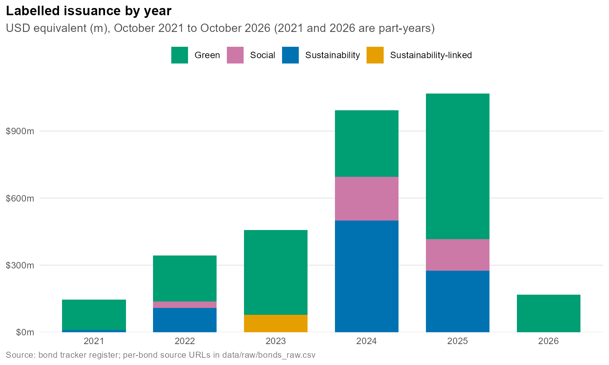
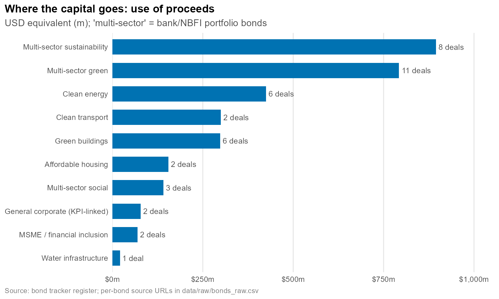
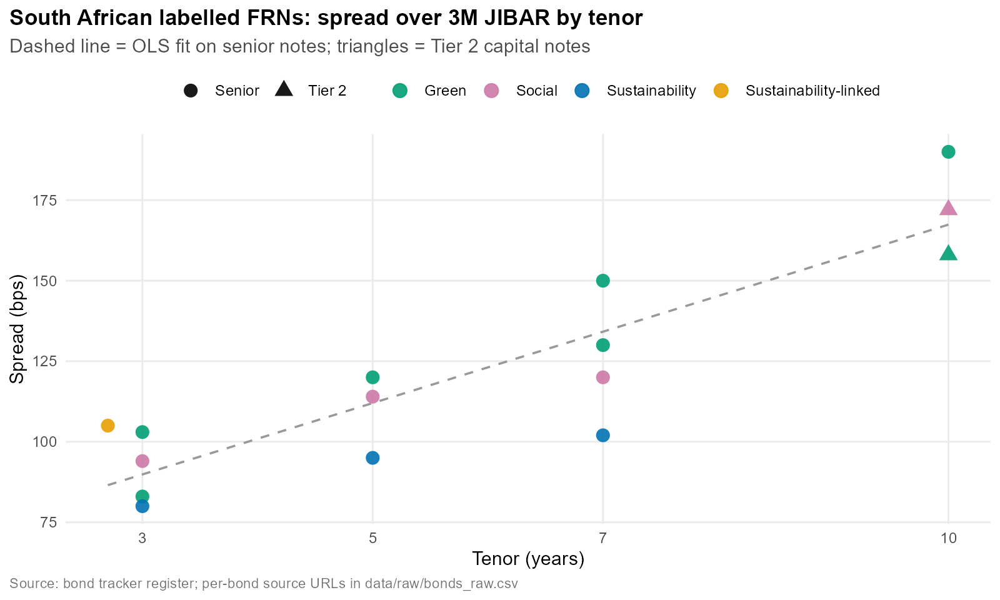

# Sustainable Infrastructure Bond Tracker (R)

A sourced database and R analysis of **green, social, sustainability and sustainability-linked corporate bonds** issued in African and Indian Ocean financial hubs from **October 2021 to October 2026**. It feeds a **3-page strategic proposal** on how a commercial bank should structure its next sustainable lending framework.

Built with `dplyr` and `ggplot2`; reports rendered with R Markdown.



## Key findings

| | |
|---|---|
| **Coverage** | 43 labelled bonds · 25 issuers · 12 markets · ≈ USD 3.2bn |
| **Who issues** | Banks issue ~61% of volume, mostly multi-sector portfolio bonds |
| **Deepest hub** | Johannesburg (JSE): ~49% of volume, all four labels, transparent FRN pricing |
| **Coupons** | Fixed coupons of 5.5%–13.5% follow the local currency curve, not the label |
| **Spreads** | JSE labelled FRNs: about +11 bps per extra year of tenor over 3M JIBAR (R² ≈ 0.79) |
| **Gaps** | Water infrastructure (1 deal), sustainability-linked structures (2 deals), patchy pricing disclosure |

<p float="left">
  
  
</p>

## Deliverables

| File | What it is |
|---|---|
| `output/bond_tracker_report.html` | Full data-driven report (market size, hubs, sectors, coupons, spreads, maturities, limitations, full register) |
| `output/strategic_proposal.docx` / `.pdf` / `.html` | 3-page committee-ready proposal for a sustainable lending framework |
| `data/processed/bonds_clean.csv` | Clean, enriched bond register |
| `output/tables/*.csv` | Summary tables behind every chart |
| `output/figures/*.png` | Six ggplot2 charts |

## Project structure

```
sustainable-bond-tracker/
├── data/
│   ├── raw/bonds_raw.csv            # hand-compiled register, one source URL per bond
│   ├── reference/fx_indicative.csv  # indicative FX for USD scaling
│   └── processed/                   # generated by R/01_clean.R
├── R/
│   ├── 00_setup.R                   # packages, palette, theme
│   ├── 01_clean.R                   # load, validate, enrich
│   ├── 02_analysis.R                # dplyr summaries + spread regression
│   └── 03_charts.R                  # ggplot2 figures
├── reports/
│   ├── bond_tracker_report.Rmd
│   ├── strategic_proposal.Rmd
│   └── reference.docx               # Word styling for the proposal
├── output/                          # rendered reports, figures, tables
└── run_all.R                        # one-click rebuild
```

## How to run

1. Open `sustainable-bond-tracker.Rproj` in RStudio.
2. Open `run_all.R` and click **Source**. Missing packages (`dplyr`, `tidyr`, `readr`, `ggplot2`, `scales`, `forcats`, `stringr`, `lubridate`, `knitr`, `rmarkdown`) install automatically.
3. Outputs are written to `output/`.

RStudio bundles Pandoc, so no LaTeX is needed: the reports render to HTML and Word. The PDF of the proposal is a convenience copy exported from the Word file.

## Data dictionary (`data/raw/bonds_raw.csv`)

| Column | Description |
|---|---|
| `bond_id` | Country-prefixed identifier |
| `issuer`, `issuer_type`, `country`, `region`, `venue` | Who issued it and where it listed |
| `label` | Green / Social / Sustainability / Sustainability-linked |
| `issue_date`, `date_basis` | Date used, and whether it is an issue, listing, offer-close or announcement date |
| `currency`, `amount_local_m`, `amount_usd_m_source` | Size in millions; USD only where the source quotes it |
| `coupon_type`, `coupon_pct`, `step_up_coupon_pct` | Fixed / Floating / Step-up / Not disclosed |
| `reference_rate`, `spread_bps` | For floating-rate notes (3M JIBAR, ZARONIA) |
| `tenor_years`, `maturity_date`, `capital_rank` | Term and seniority (Senior / Tier 2 / Secured) |
| `use_of_proceeds`, `proceeds_detail` | Sector category and detail |
| `source_url`, `notes` | Primary source and caveats |

**Rule:** where a source does not disclose a field, it is left blank, never estimated.

## Method and limitations

- **Scope:** corporate, bank, DFI, SOE and utility issuers. Sovereigns, sub-sovereign governments and supranationals are excluded.
- **Sample, not census:** private placements and some programme taps are not captured. Use the figures to read structure and direction, not market share.
- **FX:** USD values without a source-quoted figure use one indicative rate per currency (see `fx_indicative.csv`), for scale only.
- **Pricing:** 56% of deals disclose coupon or spread. The spread regression covers 15 JSE notes.
- **No greenium test yet:** this needs same-issuer vanilla comparators (planned next step).

## Extending the tracker

Add a row to `data/raw/bonds_raw.csv` with a source URL and run `run_all.R`. `01_clean.R` validates IDs, dates, labels and maturities, and stops on errors.

## Disclaimer

Compiled from public sources for research and illustration. Not investment advice. Verify figures against primary offering documents before relying on them.
